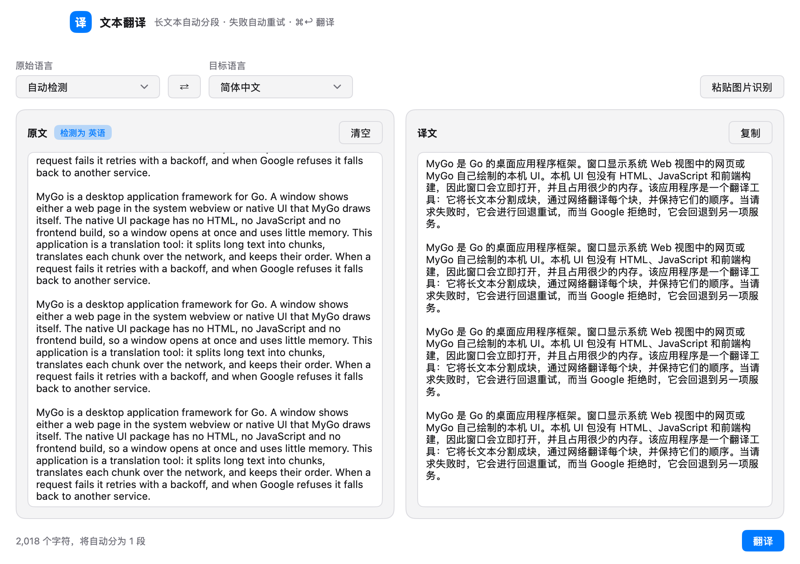

# MyGo 翻译

用 [MyGo](https://github.com/egoist/mygo) 的原生 UI 写的桌面应用：Go 画界面，没有 WebView，没有 HTML / JavaScript，也没有前端构建。



## 功能

- 原文 / 译文双栏，原文框里按 `⌘V` 直接粘贴截图即可识别文字（macOS Vision）
- 33 种目标语言，原始语言可选「自动检测」，检测结果会标在原文标题旁
- 一键反转语言和文本
- 长文本按句子切成不超过 4500 字符的段，2 段并发翻译，按原顺序拼回
- Google 翻译为主，失败时自动改用 MyMemory；可重试的错误最多重试 3 次（1s / 2s / 4s 退避）
- 底部实时显示「正在翻译 x/y 段」、重试提示与分段预估，翻译中可取消
- 一键复制译文，`⌘↩` 翻译，`Esc` 取消

## 构建与运行

需要 Go 1.27+。

```bash
go tool mygo dev     # 开发模式运行
go tool mygo build   # 打包到 build/（.app 与 .dmg）
go test ./...        # 跑测试
```

## 图标

`resources/icon.png` 是 1024×1024 的图：一块纯色蓝（`#2b60d3`）的圆角方，中间一个白色的宋体「译」。底色是平的，没有渐变也没有高光；字下方压着一层柔和的投影（贴字紧、外圈散，共两层）。方块按 macOS 的图标网格画（824 居中、圆角 185），`mygo build` 会把它编成 `.icns` 放进 `.app`，也是 dmg 的卷图标。

图是代码画出来的，不是手工导出的，改了要重跑：

```bash
go run ./tools/icongen                            # 写 resources/icon.png
go run ./tools/icongen -bg '#1f6feb'              # 换底色
go run ./tools/icongen -ink 0.40 -tshadow 0       # 字放大一点、去掉字投影
```

字形取自系统的 Songti SC（`/System/Library/Fonts/Supplemental/Songti.ttc`），`-face` 换字重、`-char` 换字。为了小尺寸下笔画不糊，字重用的是 Bold，字按墨迹外接框居中而不是按字身框。

## 代码结构

```
main.go               入口；这里有一条 //go:debug 指令，见下文
internal/app          状态与界面：窗口、语言选择、双栏编辑区、状态栏
  app.go              状态、翻译任务、取消、图片识别、复制
  view.go             整页布局，全部由 ui 包绘制
  lang.go             语言表与数字格式化
internal/translate    翻译内核：分段、Google / MyMemory、重试、并发
internal/ocr          macOS Vision 图片识字（经 osascript 的 JXA 桥，无 cgo）
tools/icongen         画应用图标：超采样 + Songti 字形，纯 Go
```

## 两个踩过的坑

**HTTP/2 会被 Google 当成机器人。** 同一份请求，用 Go 1.27 默认的 HTTP/2 客户端发出去，`translate.googleapis.com` 一律回 429 的 "Sorry..." 页面（TLS 指纹问题）；走 HTTP/1.1 就正常。整个应用只跟翻译接口说话，所以 `main.go` 里用 `//go:debug http2client=0` 一次性关掉 HTTP/2 客户端。这是编译期指令，删掉它翻译会退化成只用 MyMemory。

**图片识别不引入 cgo。** MyGo 的应用要求 `CGO_ENABLED=0`，所以没有链接 Vision.framework，而是把 PNG 写到临时文件，用 `osascript -l JavaScript` 通过 ObjC 桥跑一次 `VNRecognizeTextRequest`，再把 JSON 读回来。一次约 0.6 秒，不需要用户安装任何东西。非 macOS 平台按钮不可用。
